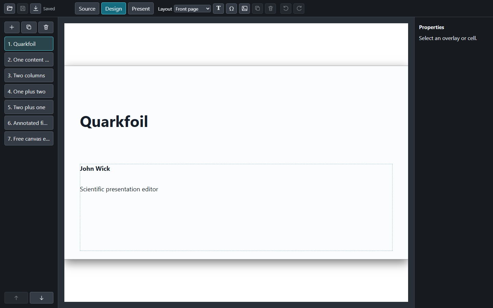

<p align="center">
  
</p>

# Quarkfoil

[](https://github.com/juanjosegarciaripoll/quarkfoil/actions/workflows/ci.yml)
[](https://juanjosegarciaripoll.github.io/quarkfoil/)

Quarkfoil is a local, browser-based editor for scientific presentations written in Markdown. It combines structured slide layouts with freely positioned Markdown, LaTeX, and image objects, and presents the result with Reveal.js.

**[Read the illustrated documentation](https://juanjosegarciaripoll.github.io/quarkfoil/)**
· **[View the live sample presentation](https://juanjosegarciaripoll.github.io/quarkfoil/example/)**

[](https://juanjosegarciaripoll.github.io/quarkfoil/)

The presentation remains a readable Markdown file accompanied by a `figures/` directory. Quarkfoil itself is installed once; its application files are not copied into every presentation project.

## Highlights

- Seven layouts: `1`, `1+1`, `1+2`, `2+1`, `0`, Front page, and Free canvas.
- Markdown and KaTeX equations remain editable rather than becoming screenshots.
- Image fit, crop focus, overlay position, size, typography, alignment, and fragments are editable graphically.
- Native MP4/WebM video plus optimized AVI/MKV conversion when FFmpeg is installed.
- Source, Design, and Present modes use the same Markdown source of truth.
- Local assets and pinned browser libraries require no runtime CDN or Node/npm toolchain.
- Presentations export as self-contained static websites, with an optional pinned-CDN mode.
- One command prints a PDF with slide-sized pages, using Chrome, Chromium, Edge, or Firefox.
- Saves are atomic, conflict-checked, and restricted to the selected presentation directory.

## Install

Quarkfoil requires Python 3.11 or newer. The recommended installation uses [uv](https://docs.astral.sh/uv/):

```powershell
uv tool install quarkfoil
```

Until a package is published, install from a local checkout:

```powershell
uv tool install .
```

Run a presentation with:

```powershell
quarkfoil path\to\presentation.md
```

If that Markdown file is missing or empty, Quarkfoil creates a minimal starter
presentation. It never replaces a nonempty file.

Quarkfoil opens a local address such as `http://127.0.0.1:8765/`. Stop the server with `Ctrl+C` in its terminal.

## Try the included example

From a source checkout:

```powershell
uv run quarkfoil example\deck.md
```

The [`example/`](example/) directory is also a template for new presentation projects.

## Use with coding assistants

Quarkfoil teaches terminal-capable assistants its current format and guarded
editing workflow directly:

```powershell
quarkfoil deck guide
```

Focused guides cover the Markdown format, layouts, overlays, assets, citations,
presentation authoring, and reconstruction from PowerPoint or PDF references.
`quarkfoil deck create presentation.md` initializes a deck without starting the
browser server, while `deck inspect` and `deck apply` make revision-checked,
atomic slide edits. See the [AI assistant guide](docs/AGENT_CLI.md).

## Export a static website

```powershell
quarkfoil export path\to\presentation.md --output presentation-site
```

The generated folder can be served by GitHub Pages or any ordinary static web
server. Add `--cdn` to reference exact, integrity-checked jsDelivr packages
instead of copying the browser libraries. See the
[export guide](docs/EXPORT.md) for details.

## Print a PDF

```powershell
quarkfoil print path\to\presentation.md
```

A headless browser renders one page per slide, each page the size of a slide
rather than a letterboxed sheet of A4. Chrome, Chromium, Edge, and Firefox all
work. See the [printing guide](docs/PRINT.md).

## Copy a project you keep editing

```powershell
quarkfoil pack path\to\presentation.md --output presentation-copy
```

This gathers the presentation, its figures, and its bibliography into a new
project folder that opens in the editor like any other. See the
[packing guide](docs/PACK.md).

## Publish a collection of talks

```powershell
quarkfoil publish path\to\presentation.md --site homepage:talks/
```

Many talks share one player and one pool of figures behind a generated listing,
locally or on a web host over rsync. See the
[publishing guide](docs/PUBLISH.md).

## Documentation

- [Installation and command-line use](docs/INSTALLATION.md)
- [Use Quarkfoil with AI assistants](docs/AGENT_CLI.md)
- [Editor guide](docs/USER_GUIDE.md)
- [Printing a PDF](docs/PRINT.md)
- [Markdown format reference](docs/FORMAT.md)
- [Security and trust model](docs/SECURITY.md)
- [Development and release guide](docs/DEVELOPMENT.md)
- [Changelog](CHANGELOG.md)
- [Third-party components and licenses](THIRD_PARTY_LICENSES.md)

## Licenses

Quarkfoil itself is released under the [MIT License](LICENSE).

Quarkfoil includes pinned, locally served copies of the following permissively
licensed components. Their complete license texts are kept in the repository
and included in distributed packages:

- [Reveal.js 5.2.1 — MIT](app/vendor/reveal/LICENSE)
- [KaTeX 0.16.22, including its distributed fonts — MIT](app/vendor/katex/LICENSE)
- [Marked 15.0.12 — MIT and BSD-3-Clause notices](app/vendor/marked/LICENSE.md)
- [js-yaml 4.1.0 — MIT](app/vendor/yaml/LICENSE)
- [bibtexParseJs 0.0.24 — MIT](app/vendor/bibtex/LICENSE)

Versions, copyright holders, source checksums, and redistribution details are
listed in the [complete third-party licensing notice](THIRD_PARTY_LICENSES.md).
